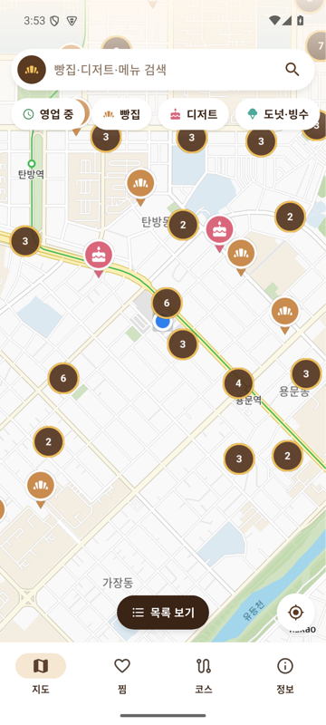

<div align="center">


# 빵지순례

**대전의 빵집·디저트·도넛·아이스크림·빙수 가게만 모아 보여주는 지도 앱**


</div>

<p align="center">
  
</p>

> 다른 상호는 지우고, 빵·디저트 가게만 남긴 지도.
> 개인·지인용으로 만든 비공식 앱입니다.

---

## 🥐 주요 기능

| | 기능 | 설명 |
|---|---|---|
| 🗺️ | **빵·디저트 전용 지도** | 기본 지도의 상가·시설 표시를 숨기고 대상 가게만 마커로 표시. 동네 이름·도로·지하철역은 남겨 위치 파악 |
| 🧁 | **업종 필터** | 빵집 / 디저트 / 도넛·빙수, **영업 중**만 보기 |
| 🔎 | **가게·상품 검색** | `소금빵`, `성심당`, `휘낭시에`처럼 가게 이름이나 대표 상품으로 검색 |
| 📍 | **내 주변** | 현재 위치 기준 거리순 목록, 지도·목록 전환 |
| 🏬 | **같은 건물 묶음** | 백화점처럼 한 건물에 모인 가게는 `3곳`으로 묶고 눌러서 선택 |
| 🕘 | **가게 상세** | 요일별 영업시간·브레이크타임·라스트오더, 휴무일, 대표 상품과 가격, 전화, 인스타그램, 출처와 확인일 |
| 🧭 | **길찾기** | 네이버지도·카카오맵 앱으로 바로 연결 |
| ❤️ | **찜** | 로그인 없이 휴대폰에 저장 |
| 🚶 | **빵지순례 코스** | 가게를 담아 순서 편집, **방문 순서 자동 추천**(직선거리 기준), 다음 가게로 길찾기 |

모르는 정보는 추측하지 않고 `미확인`으로 표시합니다. ‘영업 중’은 등록된 영업시간 기준이라 임시휴무는 반영되지 않을 수 있습니다.

## 🍞 데이터

```
행정안전부 인허가 데이터 (제과점영업·휴게음식점, 대전 전체)
        │  매월 1일 GitHub Actions가 자동 수집·분류·좌표 변환
        ▼
data/base/stores_base.json ──┐
                             ├─▶ data/stores.json ──▶ 앱이 실행 시 내려받아 저장
data/curated/*.json ─────────┘     (main 브랜치 = 검수 완료본)
 (영업시간·상품·가격·인스타그램, 출처·확인일 포함)
```

- **가게 목록**: [공공데이터포털](https://www.data.go.kr/data/15044973/fileData.do) 지방행정 인허가 데이터 중 대전의 영업 중 업소. 이용허락범위 제한 없음.
- **상세 정보**: 공식 사이트·공개된 플레이스 정보·블로그·뉴스에서 확인한 내용만 출처 링크와 함께 기록.
- **사진**: 사용 권한이 있는 사진만 씁니다. 권한이 없으면 업종 일러스트로 대체합니다.
- **검수**: 월간 작업은 결과를 바로 반영하지 않고 **PR**로 올립니다. 병합해야 앱에 반영됩니다.

| 구분 | 수 |
|---|---:|
| 등록 가게 | 982 |
| 빵집·베이커리 | 654 |
| 디저트 | 184 |
| 도넛·아이스크림·빙수 | 147 |
| 상세 정보 검수 | 44 |

<sub>2026-11-09 기준. 신규 개업·폐업은 인허가 데이터 반영 시점에 따라 늦어질 수 있습니다.</sub>

## 📁 구조

| 경로 | 내용 |
|---|---|
| [`app/`](app) | Flutter 앱 |
| [`app/third_party/kakao_map_sdk/`](app/third_party/kakao_map_sdk) | 기본 지도 표시 숨김 기능을 추가한 지도 플러그인 사본 ([변경 내역](app/third_party/kakao_map_sdk/BBANGJI_CHANGES.md)) |
| [`data/`](data) | 원본 요약·기본 목록·상세 정보·배포 데이터 |
| [`pipeline/`](pipeline) | 수집·분류·병합 스크립트 ([설명](pipeline/README.md)) |
| [`docs/DATA_SCHEMA.md`](docs/DATA_SCHEMA.md) | 데이터 형식 |
| [`.github/workflows/monthly-update.yml`](.github/workflows/monthly-update.yml) | 월간 자동 갱신 |

## 🛠️ 빌드

필요: Flutter SDK, JDK 17, Android SDK, 카카오 개발자 콘솔의 **네이티브 앱 키**, 서명 키.

`keys/` 폴더(서명 키 `key.properties`, 카카오 키 `kakao.env`)는 저장소에 올리지 않습니다.

```bash
cd app
flutter test
flutter build apk --release --target-platform android-arm,android-arm64 \
  --dart-define=KAKAO_NATIVE_KEY=<네이티브 앱 키>
```

- 카카오맵 SDK는 ARM 전용이라 APK에 ARM 라이브러리만 담습니다. x86_64 에뮬레이터에서는 ARM 변환으로 실행됩니다.
- 카카오 개발자 콘솔 **[앱] → [플랫폼 키] → [네이티브 앱 키]**에 패키지명 `com.bbangji.sunrye`와 서명 키의 키 해시를 등록하고, **[카카오맵] → [사용 설정]**을 켜야 지도가 표시됩니다.

### 데이터 직접 갱신

```bash
pip install -r pipeline/requirements.txt
python pipeline/fetch.py && python pipeline/build_base.py && python pipeline/merge.py
```

결과 요약은 `pipeline/out/report.md`에 생깁니다. 확인일이 90일 지난 상세 정보도 여기에 표시됩니다.

## ⚠️ 알아두기

- 개인·지인용으로 만든 비공식 앱입니다. 각 가게·카카오·네이버와 관계없습니다.
- 가게 정보는 바뀔 수 있습니다. 방문 전에 가게 공지를 확인하세요.
- 코스 추천은 직선거리 기준이며 도로·교통·영업시간을 고려하지 않습니다.
- 찜과 코스는 휴대폰에만 저장되어, 앱을 지우면 함께 사라집니다.
- 잘못된 정보나 빠진 가게는 [Issues](../../issues)로 알려주세요.

<div align="center"><sub>Made with 🥐 in Daejeon</sub></div>
